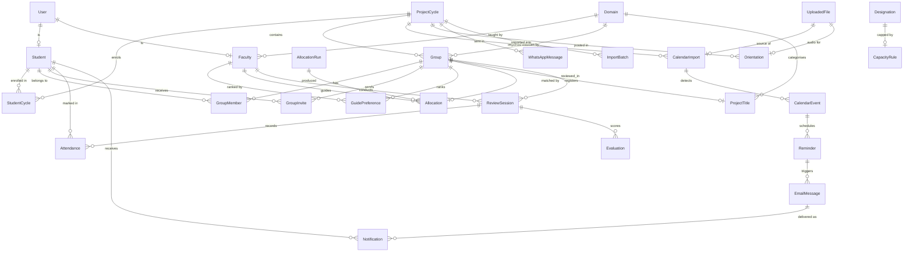

# Data model

26 models. `prisma/schema.prisma` is the source of truth; this explains the
decisions behind it.

## Entity relationships

## Beyond the specification's entity list

§5 named 18 entities. Eight more exist because the screens require them:

| Model | Why |
|---|---|
| `StudentCycle` | Cycle enrolment, so one person keeps one login across cycles |
| `GroupMember` | Membership, and the constraint enforcing one group per cycle |
| `ReviewSession` | Attendance and evaluation attach to a session, not a group |
| `AllocationRun` | The prototype's "View run history", made real |
| `Domain` | Settings master data, and the allocation engine's domain match |
| `CapacityRule` | Per-designation capacity defaults |
| `Notification` | Per-recipient inbox and delivery state |
| `ImportBatch` | The "latest import" panel and its rejected-row record |

## Invariants enforced by the database

These are not conventions the application politely observes — they are
constraints Postgres refuses to violate.

| Rule | Constraint |
|---|---|
| One active group per student per cycle | `GroupMember @@unique([cycleId, studentId])` |
| A student appears once in a group | `GroupMember @@unique([groupId, studentId])` |
| No duplicate guide across the six ranks | `GuidePreference @@unique([groupId, facultyId])` |
| One guide per rank | `GuidePreference @@unique([groupId, rank])` |
| One allocation per group | `Allocation @@unique([groupId])` |
| One session per group per phase | `ReviewSession @@unique([groupId, phase])` |
| One attendance mark per student per session | `Attendance @@unique([sessionId, studentId])` |
| One evaluation per group per session | `Evaluation @@unique([sessionId, groupId])` |
| One title per group | `ProjectTitle @@unique([groupId])` |
| One invite per group per invitee | `GroupInvite @@unique([groupId, toStudentId])` |
| One reminder per event per window | `Reminder @@unique([eventId, kind])` |
| A student is enrolled once per cycle | `StudentCycle @@unique([studentId, cycleId])` |

`GroupMember.cycleId` is denormalised from its group purely so the
one-group-per-cycle rule can be a unique index rather than application code.

## Normalisation decisions

**A student is a person, not a per-cycle row.** The prototype scoped students by
cycle, which would give one human several accounts if they appear in Major,
Mini and Internship. Here `Student` is the person, keyed by a globally unique
USN and email, with `StudentCycle` recording enrolment.

**Faculty are global; capacity is counted per cycle.** A guide holding two
groups in Major still has room in Mini, so `Faculty.capacity` is a scalar and
load is a filtered count of `Allocation` rows.

**Average CGPA is a stored Decimal, recomputed on every membership change.** It
is stored because the allocation engine sorts by it and every dashboard shows
it; it is recomputed rather than typed because the prototype's `9.12` was a
literal string.

**Imported corpus titles keep their raw labels.** `domainLabel`, `guideLabel`,
`groupLabel` and `cycleLabel` preserve free text from a CSV that does not map
onto master data, alongside the structured `domainId` used by current records.

## Indexes

Chosen for the queries the dashboards actually run at 300+ students:

- `Student(cgpa)`, `Student(fullName)` — roster sorting and search
- `Group(cycleId, status)`, `Group(cycleId, avgCgpa)` — status tiles, merit order
- `Allocation(facultyId)`, `Allocation(cycleId, status)` — per-guide load
- `Reminder(cycleId, status, dueAt)` — the cron's due query
- `Notification(studentId, createdAt)`, `Notification(toEmail, createdAt)` — inbox
- `ReviewSession(cycleId, scheduledAt)`, `(facultyId, scheduledAt)` — schedules
- `GroupInvite(toStudentId, status)` — a student's pending invites

## Storage choices

**Uploaded bytes live in Postgres.** `UploadedFile.bytes` holds calendar PDFs,
orientation audio and import sources, because Vercel has no writable filesystem
outside `/tmp` and `/tmp` does not survive between invocations. Sizes are
capped in the route handlers: 10MB for a PDF, 8MB for audio, 5MB for a CSV,
20MB total for mail attachments.

**Secrets.** Passwords are bcrypt hashes at cost 12 and are never recoverable.
Per-faculty SMTP credentials are AES-256-GCM ciphertext, because they must be
readable again to send. Password-reset tokens are stored only as SHA-256
hashes.

## Enumerations

22 enums. The ones with non-obvious semantics:

- `DeliveryMode.DRY_RUN` — a real, recorded send attempt that deliberately did
  not leave the machine. Never reported as delivered.
- `CalendarPhase` is wider than `ReviewPhase`: it adds `REVIEW` for a detected
  line identifiable only as "some review".
- `ReminderKind` has both `REVIEW_15_DAY` and `REVIEW_7_DAY`; the prototype
  only ever generated the 7-day one.
- `TitleSource` distinguishes `IMPORTED_CORPUS` from `STUDENT_SUBMISSION`, so
  one table serves both the originality corpus and the live registry.
