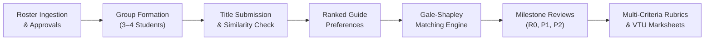
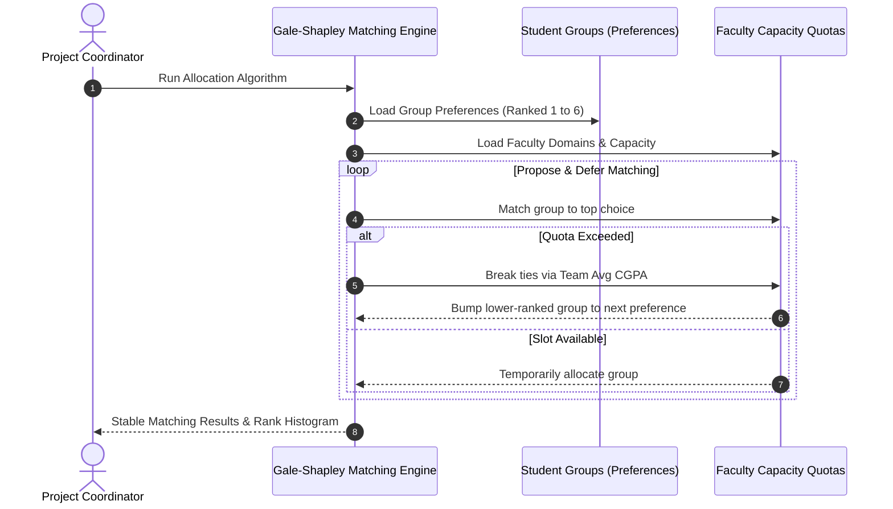

# Campus Here — Comprehensive User Manual
**Academic Project Management, Allocation & Evaluation Platform**  
*Department of Computer Science & Engineering — BMS Institute of Technology & Management*

---

## Table of Contents
1. [Platform Overview & Architecture](#1-platform-overview--architecture)
2. [Role-Based Access & Authentication](#2-role-based-access--authentication)
3. [Student User Manual](#3-student-user-manual)
   - [3.1 Registration & Admin Approval](#31-registration--admin-approval)
   - [3.2 Sign-in & Authentication (Password & OTP)](#32-sign-in--authentication-password--otp)
   - [3.3 Group Formation & Member Invitations](#33-group-formation--member-invitations)
   - [3.4 Domain Exploration & Guide Preferences](#34-domain-exploration--guide-preferences)
   - [3.5 Project Title Submission & Originality Verification](#35-project-title-submission--originality-verification)
   - [3.6 Milestone Reviews, Rubric Scores & Feedback](#36-milestone-reviews-rubric-scores--feedback)
4. [Teacher & Project Guide User Manual](#4-teacher--project-guide-user-manual)
   - [4.1 Guide Dashboard & Dual-Role Navigation](#41-guide-dashboard--dual-role-navigation)
   - [4.2 Assigned Project Groups](#42-assigned-project-groups)
   - [4.3 Title Scrutiny & Approval Workflow](#43-title-scrutiny--approval-workflow)
   - [4.4 Review Attendance Marking](#44-review-attendance-marking)
   - [4.5 Multi-Criteria Rubric Evaluations & Marksheets](#45-multi-criteria-rubric-evaluations--marksheets)
   - [4.6 Direct Communication & Reminders](#46-direct-communication--reminders)
5. [Administrator & Project Coordinator Manual](#5-administrator--project-coordinator-manual)
   - [5.1 Project Cycle Lifecycle Management](#51-project-cycle-lifecycle-management)
   - [5.2 Roster Import & Management (Students & Faculty)](#52-roster-import--management-students--faculty)
   - [5.3 Student Account Approval & Security Governance](#53-student-account-approval--security-governance)
   - [5.4 The Gale-Shapley Guide Allocation Engine](#54-the-gale-shapley-guide-allocation-engine)
   - [5.5 Group Oversight, Locks & Manual Overrides](#55-group-oversight-locks--manual-overrides)
   - [5.6 Title Corpus Management & Semantic Archive Explorer](#56-title-corpus-management--semantic-archive-explorer)
   - [5.7 Calendar Scheduling & Milestone Windows](#57-calendar-scheduling--milestone-windows)
   - [5.8 Consolidated Reports, VTU Marksheets & Data Exports](#58-consolidated-reports-vtu-marksheets--data-exports)
6. [Troubleshooting & Frequently Asked Questions](#6-troubleshooting--frequently-asked-questions)

---

## 1. Platform Overview & Architecture

**Campus Here** is an enterprise-grade academic platform built for BMSIT&M to automate and streamline the full lifecycle of undergraduate Capstone and Mini Projects.

### Core Innovations
1. **Gale-Shapley Deferred Acceptance Engine**: Eliminates manual allocation bottlenecks and lobbying by computing mathematically stable, Pareto-efficient matches between student team preferences and faculty capacity quotas.
2. **Dual-Model Originality Checker**: Employs TF-IDF lexical matching and cosine similarity across historical senior project archives to prevent duplicate project titles.
3. **Multi-Criteria Rubric Scoring**: Standardizes evaluation across Literature Review, System Architecture, Implementation, and Viva defense, with automated marksheet generation.
4. **Dual-Role Navigation**: Enables senior faculty (such as Project Coordinators / HODs) to operate both as an institutional **Admin** and a direct **Teacher / Guide** without logging out.

---

## 2. Role-Based Access & Authentication

The platform enforces strict role-based access control (RBAC):

| Role | Access URL | Core Responsibilities |
| :--- | :--- | :--- |
| **Student** | `/student/*` | Team formation, teammate invites, guide preferences, title submission, progress tracking. |
| **Faculty / Guide** | `/faculty/*` | Supervising allocated teams, title approval, marking review attendance, rubric scoring. |
| **Administrator** | `/admin/*` | Department cycles, roster bulk import, student approvals, Gale-Shapley engine, VTU marksheet exports. |

### Universal Sign-in Options
1. **Password Sign-in**: Default initial password is `bmsit123`.
2. **Email / USN Flexibility**: Students can log in using either their full BMSIT email (`1by24cs003@bmsit.in`) or their raw USN (`1BY24CS003`).
3. **One-Time Password (OTP)**: Passwordless verification sent directly to the registered email address.

---

## 3. Student User Manual

### 3.1 Registration & Admin Approval
1. Navigate to `/signup`.
2. Select your branch, enter your full name, official USN, BMSIT email (`<usn>@bmsit.in`), contact number, and choose a secure password.
3. Verify your registration using the OTP sent to your institutional email.
4. **Pending State**: Newly registered accounts enter `PENDING` status. Once the Project Coordinator approves your account in the administrative portal, your login will be immediately activated.

### 3.2 Sign-in & Authentication
1. Go to `/login` and select the **Student** tab.
2. Enter your **BMSIT Email** or your **USN** (e.g. `1BY24CS003`).
3. Enter your password (`bmsit123`) or click **Login with OTP**.
4. Upon successful authentication, you will be redirected to the student dashboard at `/student`.

### 3.3 Group Formation & Member Invitations
> Under VTU guidelines, major project teams consist of **3 to 4 students**.

1. Navigate to **My Group** (`/student/my-group`).
2. **Creating a Team**:
   - If not yet in a team, click **Create Group**.
   - You automatically become the **Team Leader**.
   - The system generates a unique team identifier (e.g. `GRP-2025-01`).
3. **Inviting Teammates**:
   - Click **Invite Teammate**.
   - Search for eligible peers using their USN or student name.
   - The platform verifies that the invited student is enrolled in the current cycle and is not already part of another team.
   - Click **Send Invitation**.
4. **Receiving & Managing Invitations**:
   - Students without a group can view incoming invitations under **Invites** (`/student/invites`).
   - Click **Accept** to join the team, or **Decline** to remain available.
   - Once accepted, team membership updates in real-time.

### 3.4 Domain Exploration & Guide Preferences
1. Navigate to **Domain & Guides** (`/student/domain`).
2. Explore the 12 departmental research domains (e.g., *AI/ML, Cybersecurity, Cloud Computing, IoT, Computer Vision*).
3. View faculty members specializing in each domain along with their designations and available student slots.
4. Navigate to **Preferences** (`/student/preferences`):
   - Select and rank your top guide preferences (**Choice 1, Choice 2, Choice 3, Choice 4**).
   - The Team Leader submits the ranked list on behalf of the group.

### 3.5 Project Title Submission & Originality Verification
1. Navigate to **Title Submission** under `/student/domain`.
2. Fill in the project details:
   - **Project Title**: A clear, technical title.
   - **Domain**: Choose the primary domain matching your proposal.
   - **Problem Statement & Scope**: Detailed technical description of the challenge and target deliverables.
   - **Methodology & Architecture**: Algorithms, libraries, hardware, and tech stack.
3. **Similarity Check**:
   - Click **Check Originality**.
   - The engine compares your proposal against previous senior project archives.
   - A similarity report displays the lexical similarity, semantic match percentage, and citation matches.
4. **Submission**:
   - Click **Submit for Approval**. Your assigned or preferred guide will review your proposal.

### 3.6 Milestone Reviews, Rubric Scores & Feedback
1. Navigate to **Timeline** (`/student/timeline`).
2. Track your group's milestone progression:
   - **Review 0 (R0)**: Problem Formulation & Feasibility.
   - **Review 1 (P1)**: Literature Survey, SRS & System Architecture.
   - **Review 2 (P2)**: Mid-Term Implementation, Module Testing & Demo.
   - **Review 3 (P3)**: Final Defense, Plagiarism-checked Report & Paper Publication.
3. Click on any completed milestone to view:
   - Your attendance status (**Present / Absent**).
   - Breakdown of rubric scores awarded by the panel.
   - Action items and recommendations provided by your guide.

---

## 4. Teacher & Project Guide User Manual

### 4.1 Guide Dashboard & Dual-Role Navigation
1. Navigate to `/login` and select the **Faculty** tab.
2. Enter your faculty email (e.g. `dhanalakshmi.bk@bmsit.in` or `veena.n@bmsit.in`) and password `bmsit123`.
3. You will land on the Faculty Portal at `/faculty`.
4. **Dual Role (Admin & Teacher Switcher)**:
   - If you hold administrative responsibilities (e.g. Dr. Dhanalakshmi B K), a pill button appears in the top navigation bar: **"Go to Admin"** / **"Go to Teacher"**.
   - Click this button anytime to toggle between your guide duties and the administrative portal without re-logging.

### 4.2 Assigned Project Groups
1. Navigate to **Assigned Groups** (`/faculty/assigned`).
2. View all project groups allocated to you by the department matching engine.
3. For each group, view:
   - Group Code (e.g. `GRP-2025-01`).
   - Project Title & Domain.
   - Team Leader and Member details (Names, USNs, CGPA, Phone, Email).
   - Current group status (`ALLOCATED` / `LOCKED`).

### 4.3 Title Scrutiny & Approval Workflow
1. Navigate to **Title Approval** (`/faculty/title-approval`).
2. View title proposals submitted by your assigned groups.
3. Review the **Similarity Score** and originality breakdown generated against the senior project corpus.
4. Actions:
   - **Approve Title**: Validates the title and records your faculty ID as reviewer.
   - **Request Revisions**: Enter specific feedback on scope adjustments, dataset changes, or methodology corrections.

### 4.4 Review Attendance Marking
1. Navigate to **Attendance** (`/faculty/mark-attendance`).
2. Select the scheduled review session (e.g. *Review 1 — Lab 301*).
3. The roster of students for that session will appear.
4. Toggle each student as **Present** or **Absent**.
5. Click **Save Attendance**. Records are timestamped and locked for institutional audit trails.

### 4.5 Multi-Criteria Rubric Evaluations & Marksheets
1. Navigate to **Evaluation** (`/faculty/evaluate`).
2. Select the group and milestone phase (`Review 1` or `Review 2`).
3. Grade each student against the departmental rubric:
   - **Literature Survey & Problem Definition** (Max 10)
   - **System Architecture & Methodology** (Max 10)
   - **Implementation & Prototype Working** (Max 15)
   - **Demonstration & Presentation** (Max 10)
   - **Defense, Viva & Q&A** (Max 5)
4. Enter qualitative feedback and specific **Action Items** for the next milestone.
5. Select the verdict: `APPROVED`, `EXCELLENT`, or `NEEDS_REVISION`.
6. Click **Submit Evaluation**. Marksheets and progress bars update instantly on both student and coordinator portals.

### 4.6 Direct Communication & Reminders
1. Navigate to **Mail & Reminders** (`/faculty/mail`).
2. Select one or all of your assigned groups.
3. Broadcast milestone alerts, report submission templates, or review scheduling notices directly to students' registered BMSIT inboxes.

---

## 5. Administrator & Project Coordinator Manual

### 5.1 Project Cycle Lifecycle Management
1. Navigate to **Cycle Settings** (`/admin/settings`).
2. **Configuring Academic Cycles**:
   - Create cycles for **Major Project (8th Sem)**, **Mini Project (6th Sem)**, or **Internships**.
   - Set **Cycle Code** (e.g. `2025-26-major`).
   - Define **Group Size Constraints** (Default: 4 members).
   - Define **Ranked Preference Count** (Default: 6 choices).
3. **Cycle Switcher**:
   - The top header switcher allows coordinators to seamlessly switch between academic years and project types.

### 5.2 Roster Import & Management (Students & Faculty)
1. **Bulk Ingestion via Excel / CSV** (`/admin/imports`):
   - Upload official university proctee lists or student admission spreadsheets.
   - The system parses USNs, Student Names, Section, Email, and Phone numbers, automatically normalizing records into the database.
2. **Faculty Roster & Quotas** (`/admin/faculty`):
   - View all registered faculty members and designated domains.
   - Set guiding capacities (e.g. Professor: 3 groups, Associate Professor: 2 groups, Assistant Professor: 2 groups).
   - Enable or disable faculty availability for matching passes.

### 5.3 Student Account Approval & Security Governance
1. Navigate to **Students** (`/admin/students`).
2. **Reviewing New Registrations**:
   - Self-registered students appear with a yellow `PENDING` badge.
   - Verify student details against the institutional proctee list.
3. **Approval Actions**:
   - Click **Approve** to activate the account for immediate login and team formation.
   - Click **Reject** to deactivate invalid or non-departmental registrations.
4. Filter by Approval Status (`ALL`, `PENDING`, `APPROVED`, `REJECTED`) or search by USN in real-time.

### 5.4 The Gale-Shapley Guide Allocation Engine
> Located at **`/admin/allocation`**, this engine replaces manual committee meetings with a mathematically optimal algorithm.

#### Steps to Execute Guide Allocation:
1. Navigate to `/admin/allocation`.
2. Inspect the **Readiness Summary**:
   - Enrolled Groups count.
   - Groups with Submitted Preferences.
   - Available Faculty Capacity.
3. Select **Dry Run** (simulates allocation without modifying database) or **Live Run**.
4. Click **Run Gale-Shapley Allocation**:
   - The engine evaluates groups in order of preference.
   - Ties are broken deterministically using team **Average CGPA**.
   - Groups are matched to their highest feasible choice within faculty quota limits.
5. Review the **Allocation Histogram**:
   - Shows what percentage of groups received their **1st Choice**, **2nd Choice**, etc.
6. Click **Commit Allocations** to lock the results and notify students and faculty.

### 5.5 Group Oversight, Locks & Manual Overrides
1. Navigate to **Groups** (`/admin/groups`).
2. Filter groups by status: `FORMING`, `SUBMITTED`, `ALLOCATED`, `LOCKED`.
3. **Manual Override**:
   - In special cases (e.g., industry-sponsored or interdisciplinary projects), click **Manual Assign** on any group row.
   - Select a faculty guide from the dropdown to override algorithmic allocation.
4. **Group Lock**:
   - Lock groups once final allocations are confirmed to freeze membership changes.

### 5.6 Title Corpus Management & Semantic Archive Explorer
1. Navigate to **Title Repository** (`/admin/titles`).
2. **Corpus Ingestion**:
   - Import CSV/Excel records of past 5 years' project titles.
3. **Similarity Engine Calibration**:
   - Adjust TF-IDF and n-gram overlap thresholds.
   - Flag titles exceeding 65% similarity for mandatory panel review.

### 5.7 Calendar Scheduling & Milestone Windows
1. Navigate to **Calendar** (`/admin/calendar`).
2. Schedule review slots by assigning dates, venues (e.g. *CSE Seminar Hall, Project Lab 301*), and panel members.
3. Automatically dispatch review reminders and calendar invitations to student and guide emails.

### 5.8 Consolidated Reports, VTU Marksheets & Data Exports
1. Navigate to **Reports & Exports** (`/admin/reports`).
2. Available exports:
   - **VTU Consolidated Evaluation Marksheet** (Excel / PDF): Contains Student USN, Name, Review 1, 2, 3 Rubric points, CIE Total, Guide Signature columns.
   - **Allocation Master Sheet** (CSV): Group Code, Leader, Members, Guide Name, Domain, Matched Preference Rank.
   - **Attendance Register**: Session-by-session attendance percentages for each student team.
3. Click **Export to Excel** or **Download CSV** for departmental documentation and NBA/NAAC accreditation audits.

---

## 6. Troubleshooting & Frequently Asked Questions

### Q1: A student sees "Incorrect email or password" on login.
- **Answer**: 
  1. Verify the student entered their correct BMSIT email (e.g. `1by24cs003@bmsit.in`) or their raw USN (e.g. `1BY24CS003`).
  2. Verify the password is `bmsit123`.
  3. Check `/admin/students` to ensure the student's account is in `APPROVED` status and not `PENDING`.

### Q2: A team leader cannot submit guide preferences.
- **Answer**: The team must meet the minimum size requirement (3 to 4 members) specified in cycle settings before preference submission unlocks.

### Q3: How does the algorithm resolve two groups ranking the same guide as Choice 1?
- **Answer**: The Gale-Shapley matching engine evaluates team **Average CGPA** as the objective tie-breaker. The higher-merit team secures the slot, and the other team is deferred to their Choice 2 without manual bias.

### Q4: Can an Administrator also act as a Project Guide?
- **Answer**: Yes. Accounts such as Dr. Dhanalakshmi B K are configured with dual credentials. Use the top navigation bar pill to toggle between the **Admin Coordinator view** and the **Teacher/Guide view** at any time.

---
*Campus Here — Developed for the Department of Computer Science & Engineering, BMSIT&M.*
